# Strom Widget

A macOS desktop widget for [Strom](https://stromapp.info) family history research: what the research is working on
right now, what it found in the last 24 hours and what waits for a decision. The data stays on the Mac.

<picture>
  <source media="(prefers-color-scheme: dark)" srcset=".github/images/hero-dark.png">
  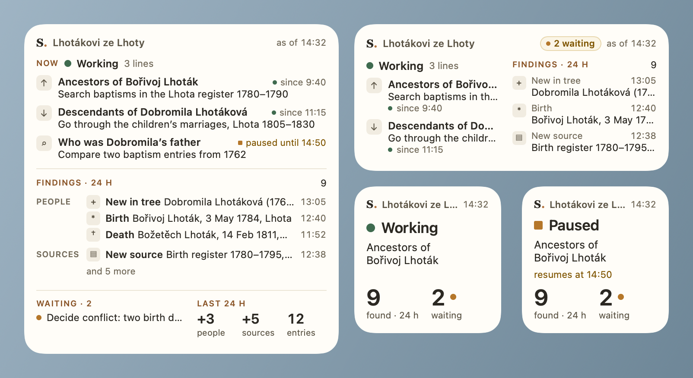
</picture>

The pictures show made-up sample research (Lhotákovi ze Lhoty). More of them: [Gallery](#gallery).

## Requirements

- macOS 14 Sonoma or later.
- [Strom Research](https://github.com/ACiDekCZ/strom-research) 1.21 or later on the same Mac.
  The research writes an overview of each tree for the widget while its bridge runs (`strom live`).

## Install

1. Download `Strom-Widget-X.Y.Z.zip` from [Releases](https://github.com/ACiDekCZ/strom-mac/releases) and check it
   against `SHA256SUMS` if wanted: `shasum -a 256 -c SHA256SUMS --ignore-missing`.
2. Unzip it and move **Strom Widget.app** to the Applications folder.
3. Open it. The first start is blocked once ("Apple could not verify…", see [Signing](#signing)).
   To allow it: **System Settings → Privacy & Security**, at the bottom **Open Anyway**, confirm with the
   Mac's password, then open the app again.
4. The app lists the research on this Mac and starts a small helper at login (listed in
   **System Settings → General → Login Items**). The helper has no window; it notices new data from the research and
   refreshes the widgets.

## Add the widget

1. Right-click an empty spot on the desktop → **Edit Widgets…**
2. Search the gallery for **Strom** and pick a size (small, medium, large or extra large).
3. Drag the widget onto the desktop.
4. With more than one research: right-click the widget → **Edit Widget** and choose the research.

A click on the widget opens the matching place in the Strom app. The widget's texts follow the language of the
research (Czech, English or German); the app can set another one.

## Gallery

Four sizes while the research works:

| Small | Medium |
|---|---|
| 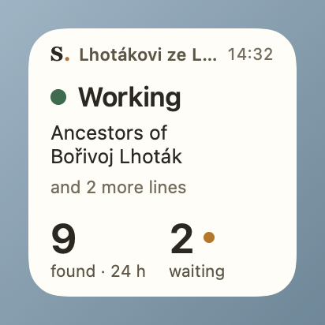 | 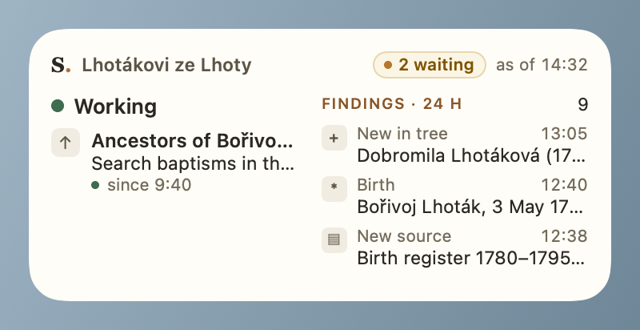 |

| Large | Extra large |
|---|---|
| 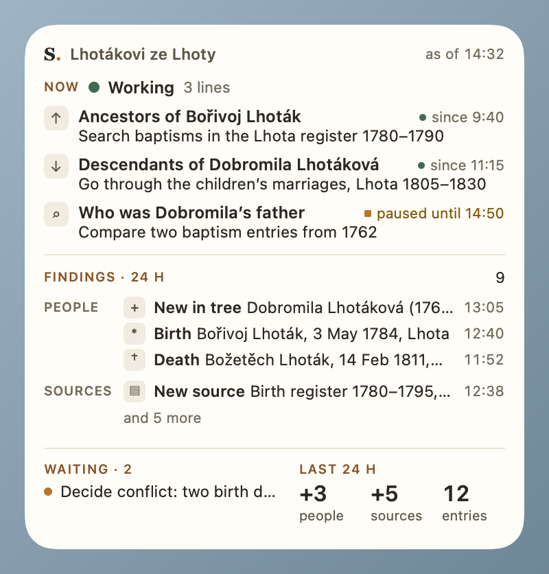 | 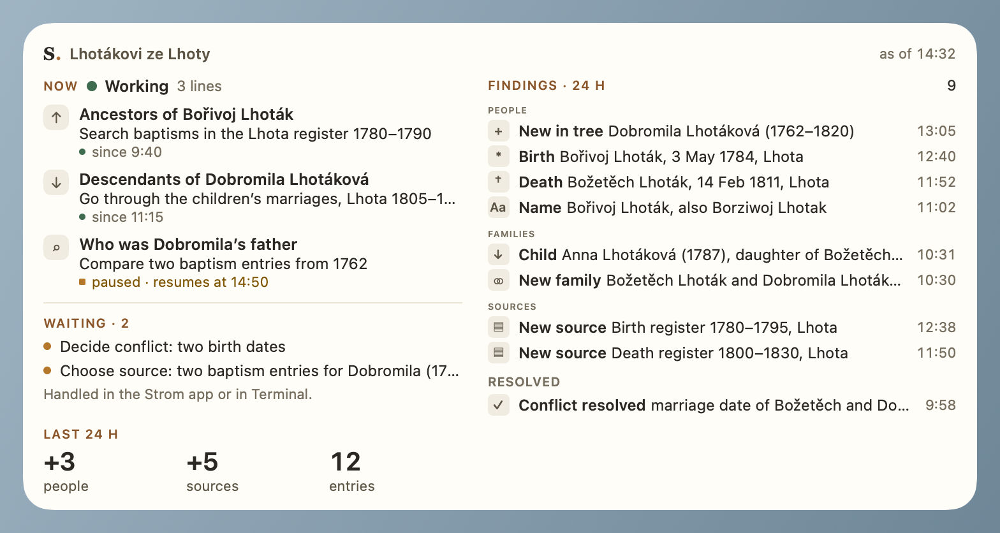 |

Light and dark:

| Light | Dark |
|---|---|
|  | 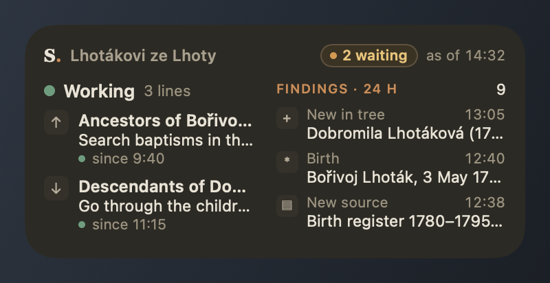 |
|  | 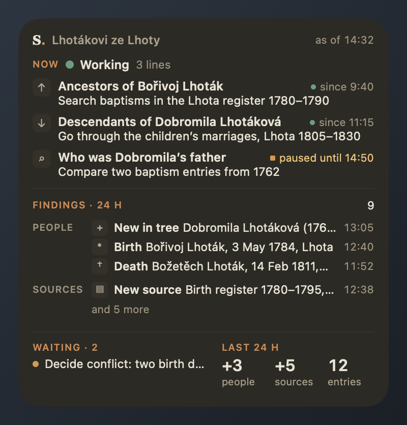 |

Other states:

| Paused | Not working right now | Research not running |
|---|---|---|
| 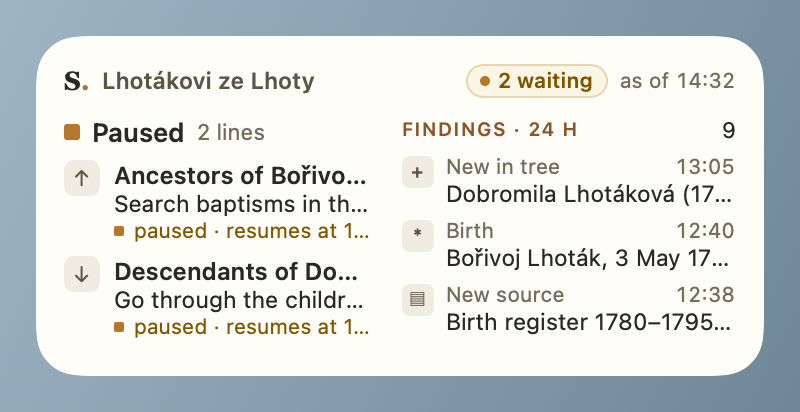 | 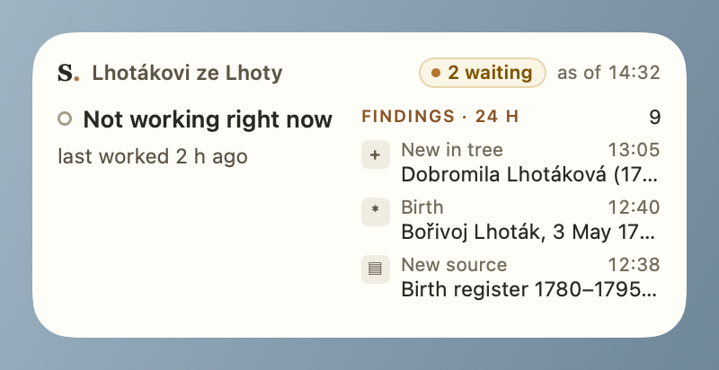 | 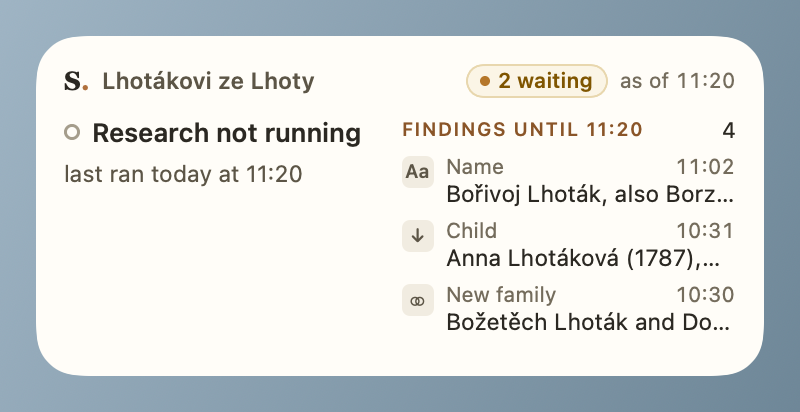 |

Without names of people (right-click the widget → **Edit Widget**), and the Strom Widget app:

| Names hidden | Strom Widget app |
|---|---|
| 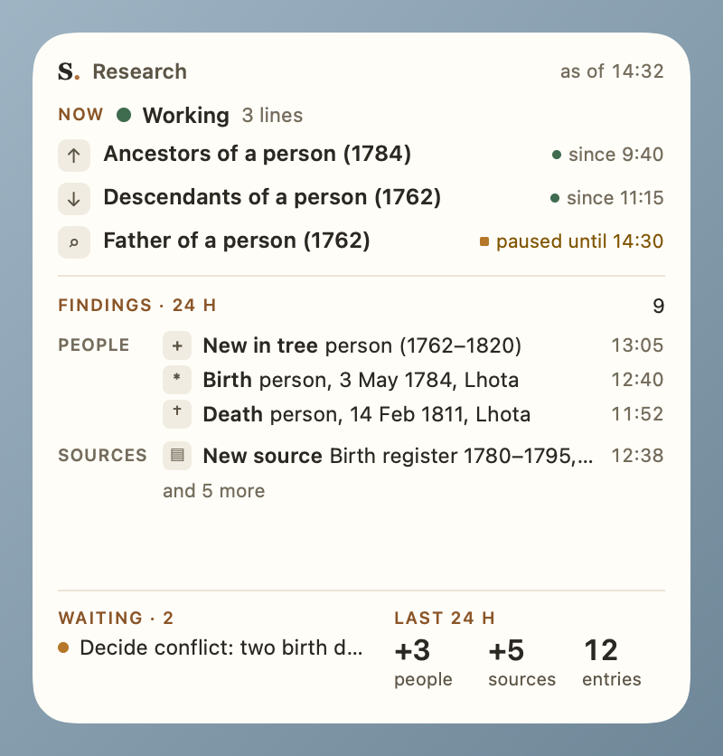 | <picture><source media="(prefers-color-scheme: dark)" srcset=".github/images/app-window-dark.png">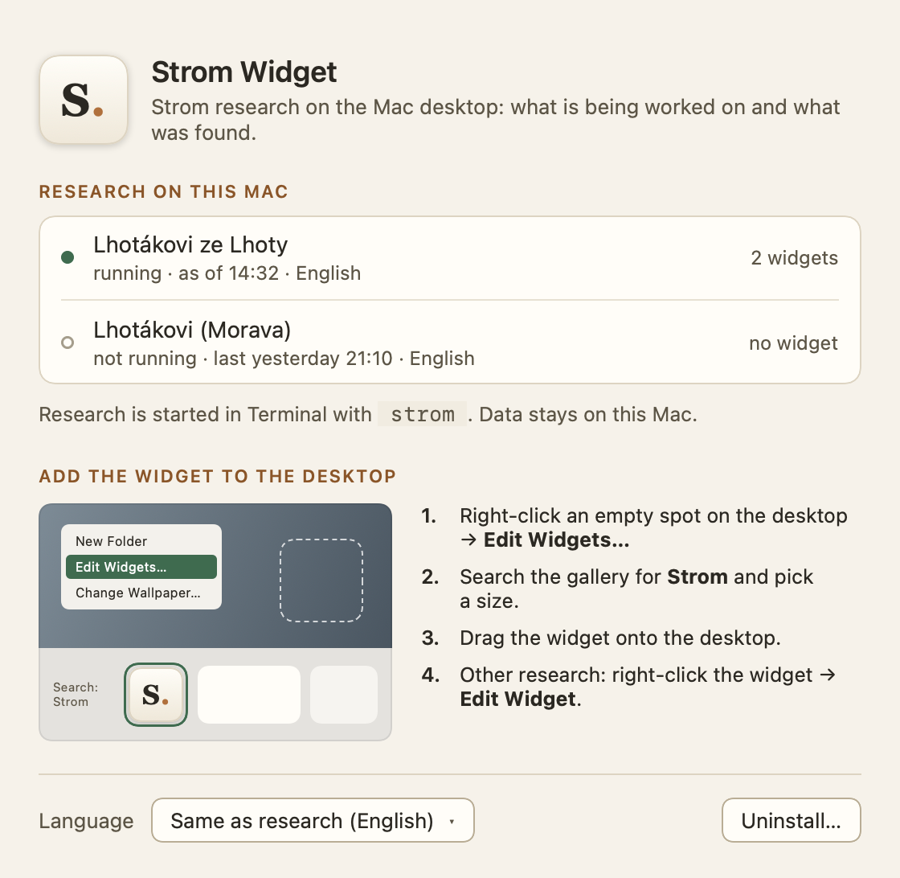</picture> |

## Where the data comes from

Only from files of the Strom research on the same Mac: `~/Library/Application Support/Strom/widget/`.
The research writes them; the widget only reads them. Nothing goes over the network, there is no telemetry and no
account. The widget can show the overview without names of people (right-click the widget → **Edit Widget**).

## Signing

Releases are signed with the project's Apple Development certificate (team TKYS4BYH6B), so the widget, the app and
its helper may share their data on any Mac. They are not notarized by Apple: macOS blocks the first start once
and it is allowed in **System Settings → Privacy & Security → Open Anyway** (step 3 of [Install](#install)).
How releases are made: [RELEASING.md](RELEASING.md).

## Uninstall

Open Strom Widget and click **Uninstall…**: it turns off the helper, deletes the widget's own data and moves the app to
the Trash. Widgets already on the desktop disappear. The research and its files are not touched.

## Build from source

Requires Xcode 26 and, after a change of `project.yml`, [XcodeGen](https://github.com/yonaskolb/XcodeGen)
(`xcodegen generate`).

```sh
xcodebuild -project StromWidget.xcodeproj -scheme StromWidget build test
```

The project is signed with the maintainer's team (`DEVELOPMENT_TEAM`, `STROM_APP_GROUP` in `project.yml`); for a
local build with another team, change both, or sign ad hoc:
`xcodebuild … CODE_SIGN_IDENTITY=- CODE_SIGN_STYLE=Manual DEVELOPMENT_TEAM= build test` (enough for the tests).

- `TEST_RUNNER_STROM_SNAPSHOT_DIR=<dir>` writes PNG previews of all widget sizes and states during the tests.
- `TEST_RUNNER_STROM_README_DIR=<dir>` writes the pictures of this README (`.github/images/`).
- `STROM_WIDGET_DIR` overrides the research folder.
- An Xcode build registers the built app with Launch Services, so the widget may appear in the widget gallery.

### Parts

- **Strom Widget** (`App/`) – host app: research on this Mac, how to add the widget, language, uninstall.
  It also opens Strom app addresses when a widget is clicked.
- **Widget** (`Extension/`) – WidgetKit extension, small to extra large, one research per widget.
- **Helper** (`Helper/`) – login item without a window. Watches the research folder, copies the overview into the
  App Group and reloads the widgets.
- **Shared** (`Shared/`) – data contract, state logic, texts (cs/en/de) and widget views.

## Related

- [stromapp.info](https://stromapp.info) – the Strom app and how the research works
- [ACiDekCZ/strom](https://github.com/ACiDekCZ/strom) – the Strom app
- [ACiDekCZ/strom-research](https://github.com/ACiDekCZ/strom-research) – the research (`strom` command)

Changes: [CHANGELOG.md](CHANGELOG.md) · [Čeština](CHANGELOG.cs.md) · [Deutsch](CHANGELOG.de.md).
Security issues: [SECURITY.md](SECURITY.md).

## License

Copyright © 2026 Milan Víšek.

Authors: Milan Víšek and Claude (Anthropic)

This program is free software: you can redistribute it and/or modify it under
the terms of the GNU Affero General Public License as published by the Free
Software Foundation, either version 3 of the License, or (at your option) any
later version.

This program is distributed in the hope that it will be useful, but WITHOUT
ANY WARRANTY; without even the implied warranty of MERCHANTABILITY or FITNESS
FOR A PARTICULAR PURPOSE. See the GNU Affero General Public License for more
details.

You should have received a copy of the GNU Affero General Public License along
with this program (see [LICENSE](LICENSE)). If not, see
<https://www.gnu.org/licenses/>.

"Strom" is the name of the original project ([stromapp.info](https://stromapp.info));
please give a modified version a name of its own.
